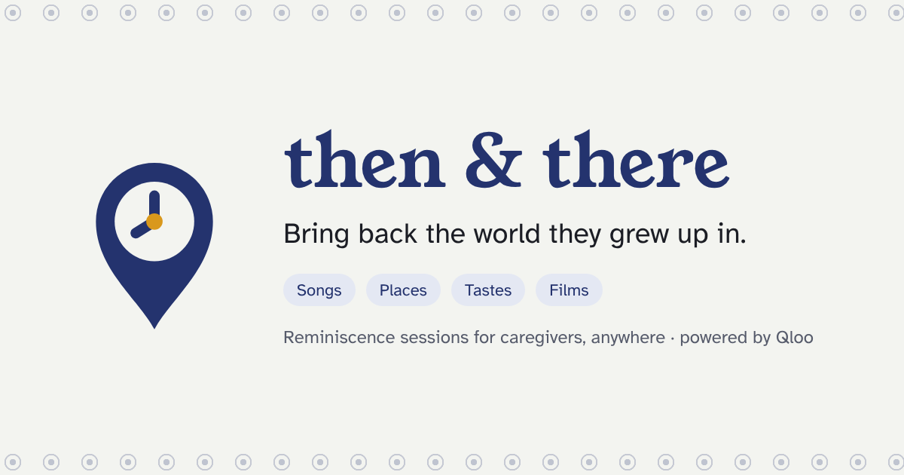
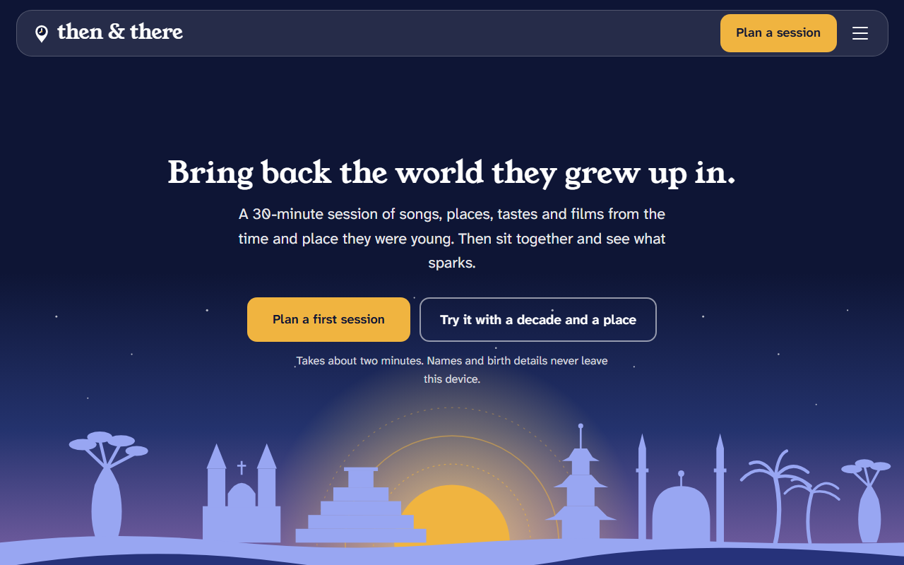
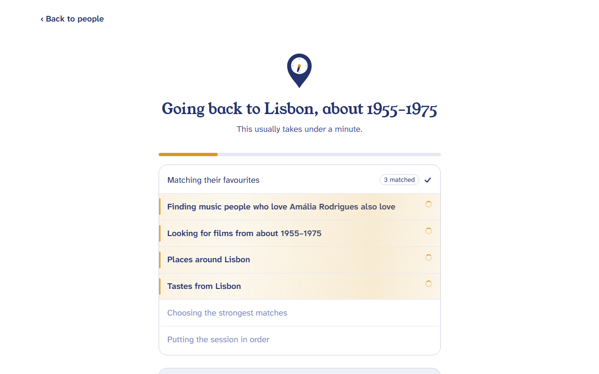
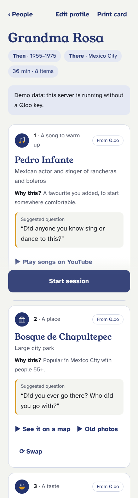
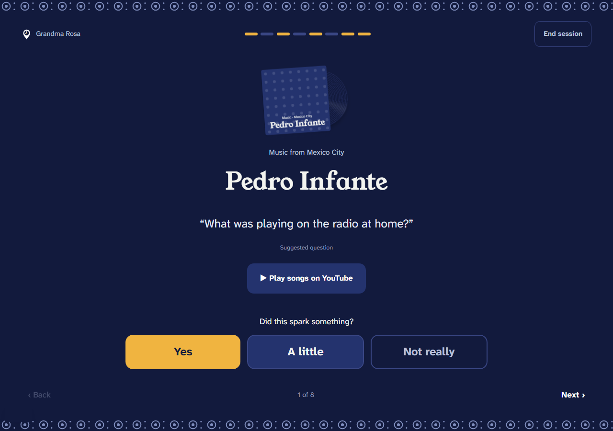
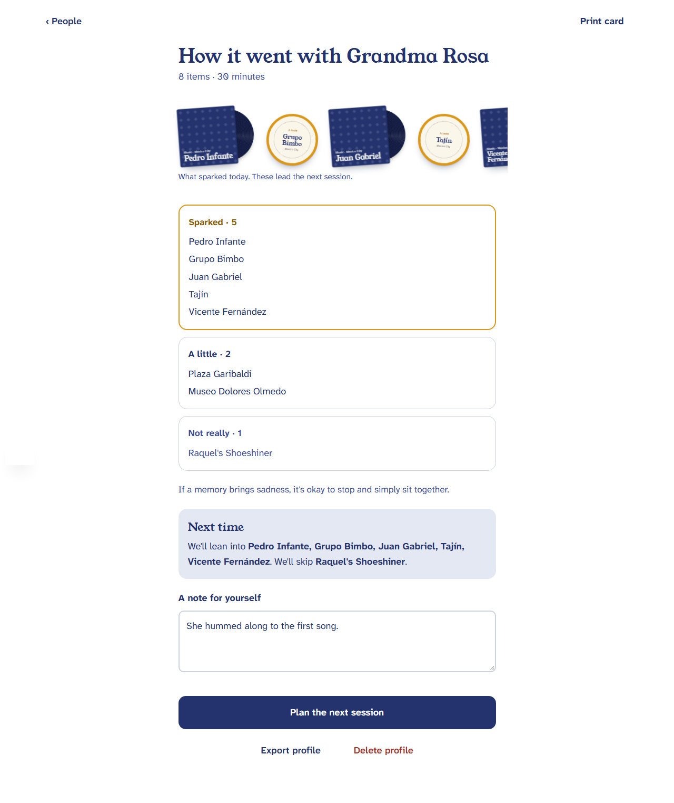
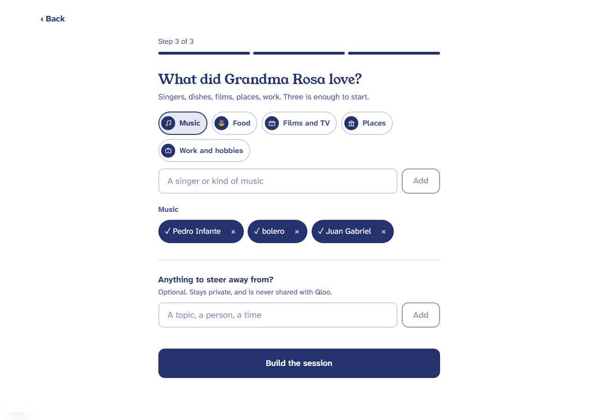

# Then & There

**Bring back the world they grew up in.**

Then & There helps caregivers anywhere in the world plan a 30-minute reminiscence session for an older adult. You tell it roughly when the person was born, where they grew up and three things they loved. A Qloo-powered agent then builds an ordered session of songs, places, tastes and films from their world. You run it full screen, one item at a time, and afterwards what sparked shapes the next session.

Built for the Qloo Agentic Hackathon. It plans activities and is not medical care.

Try it at https://then-and-there-lime.vercel.app. Pick one of the example people to see a full session.



## How it works

```
caregiver ──► web (Next.js, static) ──► server (Fastify, Node 22) ──► qloo mcp (stdio) ──► Qloo
                     │                          │
             profiles stay in             optional LLM writes the
             this browser only            suggested questions only
```

The session agent (`server/src/agent/session.ts`) runs in this order:

1. **Resolve.** Each favourite becomes a Qloo entity or tag (`qloo_describe`, `qloo_find_tags`). Ambiguous matches ask *"Which one did you mean?"* instead of guessing.
2. **Era window.** The window is the birth-decade midpoint + 10 to + 30 years, weighted toward + 14, where the musical reminiscence bump peaks. Someone born in the 1940s gets 1955 to 1975.
3. **Expand.** Four `qloo_recommend` calls run in parallel: artists, movies, places (filtered to where they grew up) and brands. Each call carries the favourites as signals, the region as `signal_location` and `"people over 55"` as the demographic (the harness maps that to Qloo's `55_and_older` bucket). Songs and brands lean toward what Qloo describes as belonging to their world, and an act that began after their years is left out (`server/src/agent/affinity.ts`). Two year-filtered `qloo insights` searches also find films from inside the era window (see *Films* under limitations). Calls are throttled (two at a time, with a shared pause after a rate limit) and cached by request hash.
4. **Filter.** Films outside the era window are dropped, along with adult ratings, a built-in list of upsetting themes (war, funerals and so on), the caregiver's private topics to avoid, duplicates, and anything marked "Not really" before.
5. **Rank.** `qloo_rank` re-scores each shortlist against the same profile. Films are then pulled gently toward the peak year, and an artist, brand or film that this server has already offered to people in other countries moves down (it is probably not specific to this place; places are exempt). Places you'd go to see (a plaza, museum, temple, market) come before restaurants, and venues and services (a barber, a banquet hall) come last. Tastes lean toward their own cooking and away from cooking described as from elsewhere, and prefer brands that already existed in their young years; a bookshop with a café is never a taste, and places of mourning are never offered. That memory lives in server memory only, resets on restart, and counts other countries, so two Mexican cities can share a Mexican brand.
6. **Compose.** The session follows an 8-slot arc: song, place, taste, film, song, place, taste, closing song. A favourite artist opens it so it starts somewhere comfortable. Leftover candidates become **Swap** alternates.
7. **Questions.** An optional LLM writes one gentle question per item. Code rejects anything that tests memory ("Do you remember…"), touches health or hits an avoided topic, and falls back to a built-in template.
8. **Adapt.** In the review, "Yes" items become signals for the next session and every item already shown is excluded.

### Qloo tools used, and why

| Tool | Why |
|---|---|
| `qloo_describe` | Turns "Pedro Infante" into one confirmed entity; `needs_input` becomes a "which one?" sheet |
| `qloo_find_tags` | Concepts like "bolero", "tamales" or "teaching" become tag signals |
| `qloo_recommend` | Cross-domain affinity: what people 55+ in this place, who like these things, also like |
| `qloo_rank` | Orders each shortlist for the same audience before it is composed |
| `qloo insights` (the harness's raw command) | The only way to filter films by release year, so the film slot comes from inside the era window |
| `qloo_capabilities` | A cheap call at server start that wakes the harness, so the first caregiver doesn't wait for a cold start |

Qloo has no song or food type, so a song slot is an artist with a "play songs" link (the caregiver picks the track), and a taste slot is a brand or a food place. The app never invents a title. `assertQlooOnly` drops any item whose ID never appeared in a Qloo response, and a test enforces it.

### A redacted request and result

A real run from the evaluation (Mexico City, born in the 1940s). Ids are shortened, and nothing personal is in any request.

```jsonc
// POST /api/sessions   (what leaves the browser: no name, no notes)
{ "birthDecade": "1940s", "region": "Mexico City, Mexico",
  "anchors": [{ "kind": "music", "label": "Pedro Infante", "qlooId": "BEC81FD4…" },
              { "kind": "music", "label": "bolero",        "tag": "urn:tag:keyword:qloo:bolero" },
              { "kind": "food",  "label": "Tamales",       "tag": "…" }],
  "avoidTopics": ["hospital"] }     // used on our server only, never sent to Qloo

// → qloo insights (the film slot: the only call that can filter by release year)
{ "type": "movie", "filter.release_year.min": 1955, "filter.release_year.max": 1975,
  "filter_location": "Mexico", "signals": ["BEC81FD4…"] }

// → qloo_recommend (one of four, run in parallel)
{ "target_type": "place", "signal_location": "Mexico City, Mexico", "filter_location": "Mexico City, Mexico",
  "demographic": "people over 55", "signals": ["BEC81FD4…"], "limit": 20 }

// ← two of the eight session items
{ "slot": 2, "kind": "place", "title": "Plaza Garibaldi",
  "why": "Popular in Mexico City with people 55+.",
  "prompt": "What was it like there?", "promptSource": "template",
  "provenance": { "source": "qloo", "operation": "recommend", "qlooType": "place", "qlooId": "26D23F8E…" } }
{ "slot": 4, "kind": "film", "title": "Raquel's Shoeshiner", "year": 1957,
  "why": "From 1957. From the years they were growing up, chosen to go with Pedro Infante and bolero.",
  "prompt": "Who would you go to the cinema with?", "promptSource": "template",
  "provenance": { "source": "qloo", "operation": "insights", "qlooType": "movie", "qlooId": "6A88C097…" } }
```

The film's `why` says it was found by year. It never claims "people 55+ liked it", because that isn't how it was found.

### How long it takes, and what the caregiver sees

A session is built from about eight Qloo calls, and Qloo's response time varies from day to day. In our tests a build took 20 to 60 seconds on a good day and longer when Qloo was slow. The build screen shows each real step as it happens (over SSE), a progress bar, what each step found, and calm tips for the session. A film search that times out is not repeated, and the film step has a time budget (`FILM_BUDGET_MS`), so a slow film query can't hold the whole session back. If it runs out, the session is built without era films and says so.

## Evaluation

We ran 12 invented people from six countries (Mexico, UK, Nigeria, India, the Philippines, Japan) against live Qloo. Results, method and caveats are in [docs/EVALUATION.md](docs/EVALUATION.md). Re-run it with `node scripts/evaluate.mjs`.

| Bar | Result |
|---|---|
| Full 8-item session for at least 10 of 12 | 12 of 12 |
| Every item carries Qloo provenance | 96 of 96 |
| Dated items (films) inside the era window | 12 of 12 |
| Caregiver's avoid topics and built-in hard topics | 0 hits |
| Gentle questions (never test, never health) | 0 of 96 flagged |
| Build time | 15 to 35 s on a day Qloo was quick; minutes when it isn't |
| Items that fit the region or favourites (read by hand) | about 71% (up from 59% over three rounds of fixes), short of the 85% bar |

We missed the fit bar. Mexico City, Guadalajara, Ibadan and Lagos had 7 to 8 of 8 items fit, and Tokyo and Osaka reached 6. London, Mumbai, Chennai and Manila are weakest (3 to 4 of 8) because Qloo's data for older audiences is thin there. The film slot is the weakest part everywhere.

We ran the evaluation three times. It found a silent failure (Qloo can't match "Mumbai, India" but can match "Mumbai", so the session now retries with the city and says so). It also found quality problems that we fixed and re-measured: generic films, foreign songs and brands, the same names repeating across countries, and generic venues in the place and taste slots.

## Responsible data handling

- Sent to Qloo: favourites, the age group "55 and older", and the region they grew up in.
- Never sent anywhere: names or nicknames, birth dates, health information, or the caregiver's topics to avoid. `parseProfile` rebuilds the request from known fields only, so a stray `name` field is dropped. A test proves that neither names nor avoid topics reach Qloo.
- Each favourite also carries Qloo's own short description of it (`blurb`), so our server can tell which nationality counts as "theirs" ("Mexican singer", "Japanese singer"). It stays on our server and is never sent to Qloo or the LLM.
- Profiles live in the browser's `localStorage`. Export and delete are in the review screen.
- Results are aggregate affinities. The copy says "often enjoyed by people 55+ who like…", never "she will remember".
- The Qloo key lives only in the server's environment. The browser never talks to Qloo or the LLM.

## Run it locally

Requires Node 22.19+.

```bash
# 1) server: demo fixtures without a key; real Qloo with one
cd server && npm install
QLOO_API_KEY=your_key npm run dev        # or: QLOO_MODE=mock npm run dev
# Hackathon keys only work on the hackathon host. Also set both of these, to the same URL:
#   QLOO_BASE_URL=https://hackathon.api.qloo.com  QLOO_TRUSTED_BASE_URL=https://hackathon.api.qloo.com
# (without them the key gets 401 from api.qloo.com). Keep the values in a git-ignored .env and load it with
#   node --env-file=../.env --import tsx src/index.ts
# optional, for written questions: LLM_BASE_URL=… LLM_API_KEY=… LLM_MODEL=…

# 2) web
cd ../web && npm install
NEXT_PUBLIC_API_URL=http://localhost:8787 npm run dev   # → http://localhost:3000
```

Tests: `cd server && npm test`. They cover the era window, the full arc for three continents, the Qloo-only guard, the avoid filters, question safety, the adapt loop and swap.

Before the first real run, `bash scripts/probe.sh` checks what Qloo returns for the demo regions and writes the results to `probe-out/`.

## Deploy

[docs/DEPLOY.md](docs/DEPLOY.md) has the steps, a checklist and troubleshooting. In short:

- **API:** Render (`render.yaml`), Railway or Fly. It has to be a long-running process, because the Qloo harness doesn't run serverless. Set `QLOO_API_KEY`, `QLOO_BASE_URL` and `QLOO_TRUSTED_BASE_URL` (both `https://hackathon.api.qloo.com` for a hackathon key), the optional `LLM_*` variables, and `ALLOWED_ORIGIN` (your web URL). `GET /api/health` reports `mode: live` when the key is in place.
- **Web:** a static export (`npm run build` → `web/out`) for Vercel or any static host. Set `NEXT_PUBLIC_API_URL` and `NEXT_PUBLIC_SITE_URL` before building, since they are baked in at build time.

## Quality checks

Lighthouse on the production build (local, headless Edge):

| Page | Accessibility | Best practices | SEO |
|---|---|---|---|
| Landing | 100 | 100 | 100 |
| Onboarding (`/new`) | 100 | 100 | 100 |
| Privacy (`/about`) | 100 | 100 | 100 |

Cumulative layout shift on the landing is 0.006. Performance scores measured on a slow development machine swung between 37 and 74, so they aren't reliable. Measure the deployed site with PageSpeed Insights.

## Screens

Captured from the running app against live Qloo, using the example people (no real names).

| | |
|---|---|
|  |  |
|  |  |
|  |  |

On a phone: [landing](docs/screens/landing-phone.png), [plan](docs/screens/plan-phone.png) and [stage](docs/screens/stage-phone.png). Also: [privacy page](docs/screens/privacy.png).

The app has eight screens: landing, profile builder, building (live steps over SSE), session plan, stage (full screen, wake lock, 72px buttons), review, print card (A4), and about and privacy.

## Known limitations

- Item shapes in Qloo's `results` were confirmed against live output (`server/src/qloo/normalize.ts` still reads them defensively).
- Films: Qloo's `recommend` tool can't filter by release year and returns only recent hits for a 55+ audience, so films come from `qloo insights` (the harness's raw command) with a release-year window. One search uses the favourites alone ("films like what they love, from those years"), which finds films that belong to their world; another finds the best-known films of the era in their place. Both are chosen by year, not by audience, and the copy says so. A location *filter* on films isn't used: it returned the same global classics for every country. Only the live transport does this; mock mode skips it.
- The era window applies to items with a release year (films). Artists, places and brands rely on the 55+ demographic and the region signal, so they're "of their world", not proven to be "of that decade".
- Recommendations describe what people with similar tastes and background often enjoy. They say nothing about any individual's memories, health or history.
- Qloo's concept search (genres, dishes) works on English names. A favourite typed in another script (for example Tamil or Arabic) can come back "not found"; the app says so and suggests the English name. Artists and films written in other scripts are matched more often.
- A region typed as a whole country (for example just "Japan") is too large for Qloo to filter places by, so that session has no place items and says why. A city or town works best.
- Coverage is uneven. Large cities (Mexico City, Liverpool, Lagos, Tokyo) return full sessions; smaller or less-documented places can return fewer places and tastes, and the session says so rather than padding it.
- The interface is in English (every string is in `web/lib/copy.ts`). Content keeps its original spelling. Suggested questions use English templates (or an LLM if one is configured).
- The repeat nudge depends on what the server has recently offered, so results for a region can differ slightly depending on what was built before it. It is a nudge, not a ban: if an item is the only good option it is still used.
- Build time depends on Qloo. It was 20 to 60 seconds on good days and more than two minutes when Qloo was slow.
- Sessions are kept on the server for 2 hours for Swap. After that, plan a new one.

## Licence

MIT. See [LICENSE](LICENSE).
