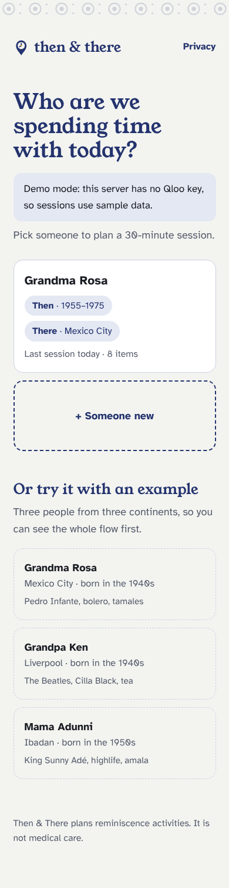

# Then & There

**Bring back the world they grew up in.**

Then & There helps caregivers anywhere in the world plan a 30-minute reminiscence session for an older adult. You tell it roughly when the person was born, where they grew up and three things they loved. A Qloo-powered agent then builds an ordered session from their world: **songs, places, tastes and films**. You run the session full-screen, one item at a time. Afterwards, what sparked shapes the next session.

Built for the **Qloo Agentic Hackathon**. It plans activities and is not medical care.


## How it works

```
caregiver ──► web (Next.js, static) ──► server (Fastify, Node 22) ──► qloo mcp (stdio) ──► Qloo
                     │                          │
             profiles stay in             optional LLM writes the
             this browser only            suggested questions only
```

The session agent (`server/src/agent/session.ts`) runs in this order:

1. **Resolve.** Each favourite becomes a Qloo entity or tag (`qloo_describe`, `qloo_find_tags`). Ambiguous matches ask *"Which one did you mean?"* instead of guessing.
2. **Era window.** The window is the birth-decade midpoint + 10 to + 30 years, weighted toward + 14, where the musical reminiscence bump peaks. Someone born in the 1940s gets **1955–1975**.
3. **Expand.** Four `qloo_recommend` calls run in parallel: artists, movies, places (filtered to where they grew up) and brands. Each call carries the favourites as signals, the region as `signal_location` and `"people over 55"` as the demographic (the harness maps that to Qloo's `55_and_older` bucket).
4. **Filter.** Films outside the era window are dropped, along with adult ratings, a built-in list of upsetting themes (war, funerals and so on), the caregiver's private topics to avoid, duplicates, and anything marked "Not really" before.
5. **Rank.** `qloo_rank` re-scores each shortlist against the same profile. Films are then pulled gently toward the peak year.
6. **Compose.** The session follows an 8-slot arc: song → place → taste → film → song → place → taste → closing song. A favourite artist opens it, to start somewhere comfortable. Leftover candidates become **Swap** alternates.
7. **Questions.** An optional LLM writes one gentle question per item. Code rejects anything that tests memory ("Do you remember…"), touches health or hits an avoided topic, and falls back to a built-in template.
8. **Adapt.** In the review, "Yes" items become signals for the next session and every item already shown is excluded.

### Qloo tools used, and why

| Tool | Why |
|---|---|
| `qloo_describe` | Turns "Pedro Infante" into one confirmed entity; `needs_input` becomes a "which one?" sheet |
| `qloo_find_tags` | Concepts like "bolero", "tamales" or "teaching" become tag signals |
| `qloo_recommend` | Cross-domain affinity: what people 55+ in this place, who like these things, also like |
| `qloo_rank` | Orders each shortlist for the same audience before it is composed |

**Qloo has no song or food type,** so a song slot is an *artist* with a "play songs" link (the caregiver picks the track), and a taste slot is a *brand* or a food place. The app never invents a title. `assertQlooOnly` drops any item whose ID never appeared in a Qloo response, and a test enforces it.

### A redacted request → result

```jsonc
// POST /api/sessions   (what leaves the browser: no name, no notes)
{ "birthDecade": "1940s", "region": "Mexico City, Mexico",
  "anchors": [{ "kind": "music", "label": "Pedro Infante", "qlooId": "…" },
              { "kind": "music", "label": "bolero", "tag": "urn:tag:keyword:qloo:bolero" }],
  "avoidTopics": ["…"] }            // used on our server only, never sent to Qloo

// → qloo_recommend (one of four)
{ "target_type": "movie", "signals": ["…"], "signal_tags": ["urn:tag:keyword:qloo:bolero"],
  "signal_location": "Mexico City, Mexico", "demographic": "people over 55", "limit": 20 }

// ← one session item
{ "slot": 4, "kind": "film", "title": "Tizoc", "year": 1957,
  "why": "From 1957. Often enjoyed by people 55+ who like Pedro Infante and bolero.",
  "prompt": "Where did you go to the pictures?", "promptSource": "template",
  "provenance": { "source": "qloo", "operation": "recommend", "qlooType": "movie", "qlooId": "…" } }
```

## Responsible data handling

- **Sent to Qloo:** favourites, the age group "55 and older", and the region they grew up in.
- **Never sent anywhere:** names or nicknames, birth dates, health information, or the caregiver's topics to avoid. `parseProfile` rebuilds the request from known fields only, so a stray `name` field is dropped. A test proves that neither names nor avoid topics reach Qloo.
- Profiles live in the browser's `localStorage`. Export and delete are in the review screen.
- Results are **aggregate affinities**. The copy says "often enjoyed by people 55+ who like…", never "she will remember".
- The Qloo key lives only in the server's environment. The browser never talks to Qloo or the LLM.

## Run it locally

Requires **Node 22.19+**.

```bash
# 1) server: demo fixtures without a key; real Qloo with one
cd server && npm install
QLOO_API_KEY=your_key npm run dev        # or: QLOO_MODE=mock npm run dev
# Hackathon keys only work on the hackathon host. Also set both of these, to the same URL:
#   QLOO_BASE_URL=https://hackathon.api.qloo.com  QLOO_TRUSTED_BASE_URL=https://hackathon.api.qloo.com
# (without them the key gets 401 from api.qloo.com). Keep the values in a git-ignored .env and load it with
#   node --env-file=../.env --import tsx src/index.ts
# optional, for written questions: LLM_BASE_URL=… LLM_API_KEY=… LLM_MODEL=…

# 2) web
cd ../web && npm install
NEXT_PUBLIC_API_URL=http://localhost:8787 npm run dev   # → http://localhost:3000
```

Tests: `cd server && npm test`. They cover the era window, the full arc for three continents, the Qloo-only guard, the avoid filters, question safety, the adapt loop and swap.

Before the first real run, `bash scripts/probe.sh` checks what Qloo returns for the demo regions and writes the results to `probe-out/`.

## Deploy

- **API:** Render (`render.yaml`), Railway or Fly. It has to be a long-running process, because the Qloo harness doesn't run serverless. Set `QLOO_API_KEY`, `QLOO_BASE_URL` and `QLOO_TRUSTED_BASE_URL` (both `https://hackathon.api.qloo.com` for a hackathon key), the optional `LLM_*` variables, and `ALLOWED_ORIGIN` (your web URL).
- **Web:** a static export (`npm run build` → `web/out`) for Vercel or any static host. Set `NEXT_PUBLIC_API_URL` and `NEXT_PUBLIC_SITE_URL`.

## Screens

| | |
|---|---|
|  |  |
|  |  |

Home · Profile builder · Building (live steps over SSE) · Session plan · Stage (full-screen, wake lock, 72px buttons) · Review · Print card (A4) · About and privacy.

## Known limitations

- Item shapes in Qloo's `results` were confirmed against live output (`server/src/qloo/normalize.ts` still reads them defensively).
- Films: Qloo's `recommend` tool can't filter by release year and returns only recent hits for a 55+ audience, so films come from `qloo insights` (the harness's raw command) with a release-year window: some made in the country they grew up in, some of the best known. Those are chosen by year, not by audience, and the copy says so. Only the live transport does this; mock mode skips it.
- The era window applies to items with a release year (films). Artists, places and brands rely on the 55+ demographic and the region signal, so they're "of their world", not proven to be "of that decade".
- Recommendations describe what people with similar tastes and background often enjoy. They say nothing about any individual's memories, health or history.
- The interface is in English (every string is in `web/lib/copy.ts`). Content keeps its original spelling.
- Sessions are kept on the server for 2 hours for Swap. After that, plan a new one.

## Licence

MIT. See [LICENSE](LICENSE).
